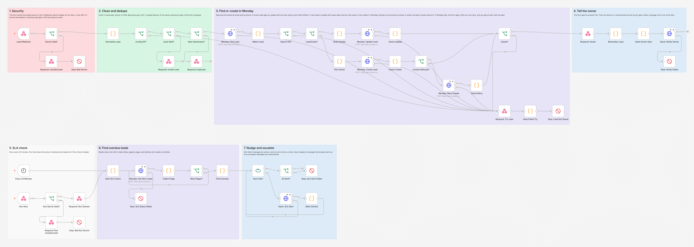
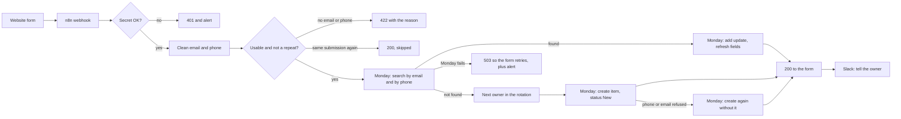
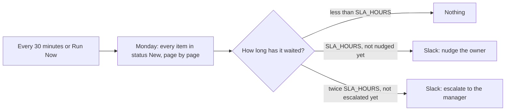

# Monday.com Lead Intake with Dedupe, Round Robin and SLA Nudges

Website form leads land cleanly in a Monday.com CRM board, without duplicates, each with an owner picked by round robin. If a lead sits in status New too long, the owner gets a Slack nudge, and if it waits twice as long, the manager hears about it. Built with n8n.



## The problem

Leads from the website arrive by email or get typed into the CRM by hand, so some are entered twice, some are entered with typos and some are never entered at all. Nobody is clearly responsible for a new lead, so the fast ones get picked up and the rest wait. And when a lead has been sitting untouched for half a day, nobody notices until the prospect has already gone with someone else.

## What this does

1. **Takes every form post on a protected webhook.** The form sends a shared secret. Anything without it gets a 401 and raises an alert.
2. **Cleans the data.** Emails are lowercased, phone numbers are turned into one format (E.164, for example `+12025550101`), and posts with no usable email or phone get a 422 with the reason.
3. **Never creates a duplicate.** It searches the Monday board by email and by phone. If the person is already there, it adds an update to their item ("New inquiry from the website: ...") and refreshes a few fields instead of creating a second item. If the form delivers the same submission twice, even at the same moment, there is still one item.
4. **Creates new leads properly.** New items get the email, phone, message, company and source in the right columns, status New, and an owner. If Monday refuses the phone number (it checks every number with Google's libphonenumber), the lead is still saved, with the number in the message.
5. **Shares leads fairly.** Owners take turns (round robin). Anyone marked as away is skipped.
6. **Tells the owner in Slack** with a link straight to the item, for new leads and for returning ones.
7. **Makes sure nobody waits.** Every 30 minutes it checks every item still in status New. After `SLA_HOURS` the owner gets one nudge. After twice that, the manager gets one escalation. Each lead is nudged once and escalated once, never more.
8. **Fails safely.** If Monday is down, the form gets a 503 so it can retry, and you get a Slack alert with the full lead so nothing is lost. A retry never creates a second item.

## How it works

The intake flow, once per form post:



The SLA check, every 30 minutes (or on demand through the protected Run Now webhook):



Monday's API is GraphQL, and it reports most problems (a wrong column ID, a bad column value, a missing label) with HTTP 200 and an `errors` list. The workflow checks the body of every answer, not just the status code. Column values go to Monday as one JSON string in the format each column type expects, and every request sends the `API-Version` header.

Every change sends Monday's `Idempotency-Key` header, built from the submission (its ID, or its email, phone and message). n8n's own retries, and a second delivery of the same submission that arrives while the first is still running, get Monday's first answer back instead of creating a second item.

The form gets its answer as soon as Monday has the lead. The Slack message goes out after that, so a slow Slack never delays the form.

## Workflow at a glance

| Step | Nodes | What it does |
|---|---|---|
| 1 | Lead Webhook, Secret Valid?, Respond: Unauthorized, Stop: Bad Secret | Receives the form post. Checks the `X-Webhook-Secret` header (or `?key=` in the URL for form tools that cannot set headers) |
| 2 | Normalize Lead, Config OK? | Reads the fields, lowercases the email, turns the phone into E.164, checks the config and builds the Monday search |
| 3 | Lead Valid?, Respond: Invalid Lead | Answers 422 when there is no usable email or phone |
| 4 | New Submission?, Respond: Duplicate | Skips a submission that was already saved in the last 24 hours |
| 5 | Monday: Find Lead, Match Lead, Search OK? | One request with two `items_page_by_column_values` lookups (email and phone). Every phone hit is checked exactly, because Monday's phone search is a "contains" match |
| 6 | Lead Exists? | Known lead goes to step 7, new lead to step 8 |
| 7 | Build Update, Monday: Update Lead, Check Update | `create_update` with the new inquiry, plus two `change_multiple_column_values`: one for the last inquiry date and the source, one for any empty contact field. If Monday refuses a contact detail, the inquiry and the refresh are still saved |
| 8 | Pick Owner, Monday: Create Lead, Check Create | Picks the next owner who is not away, then `create_item` with status New and the mapped columns |
| 9 | Contact Refused?, Monday: Retry Create, Check Retry | If Monday refused only the phone number or the email, the item is created again without it. The value goes into the message and the owner is asked to check it |
| 10 | Saved?, Respond: Try Later, Note Failed Try, Stop: Lead Not Saved | If Monday failed, the form gets a 503 with `Retry-After` and the alert carries the whole lead. If Monday refused the lead, the next try uses a new `Idempotency-Key` |
| 11 | Respond: Saved, Remember Lead | Answers the form with the item ID, then remembers the submission and moves the round robin pointer |
| 12 | Build Owner Alert, Slack: Notify Owner, Stop: Notify Failed | Slack message to the owner with a link to the item |
| 13 | Every 30 Minutes, Run Now, Run Secret Valid?, Respond: Run Started, Respond: Run Unauthorized, Stop: Bad Run Secret | The two ways the SLA check starts. Run Now needs the `X-Run-Secret` header |
| 14 | Start SLA Check, Monday: Get New Leads, Collect Page, More Pages?, Stop: SLA Query Failed | Reads every item in status New, 100 per page, following Monday's cursor |
| 15 | Find Overdue | Decides who gets a nudge or an escalation, one Slack message per person |
| 16 | Each Alert, Slack: SLA Alert, Mark Alerted, All Sent?, Stop: SLA Alert Failed | Sends the messages one at a time and remembers only the ones Slack accepted |

## What the team gets

Slack messages from the test run, as Slack shows them (all data made up):

```
@Alex New lead for you: Jamie Rivera
Company: Rivera Roofing
Email: jamie.rivera@example.com
Phone: +12025550101
Source: Website contact form
Message: Need a quote for a new roof.
The house is two floors.
Open in Monday
```

```
@Alex Returning lead: Jamie Rivera sent a new inquiry (matched by email).
```

```
@Sam New lead for you: Ari Novak
...
Monday did not accept the phone number (555) 201-0123, so the lead was saved without it. You find it in the message; please check with the lead.
```

```
@Alex This lead is still New after more than 2 h. Please reach out:
- Avery Stone, waiting 2.5 h
```

```
@Manager SLA missed: 1 lead is still New after more than 4 h.
- Casey Fox, owner @Alex, waiting 5.0 h
```

Lead names are links to the Monday item. Leads with no owner, an owner who is not in `OWNERS_JSON` or an owner who is away are listed in the team channel instead, so someone can assign them.

When something fails, the error alert workflow posts the reason and a link to the failed run, for example (raw Slack text):

```
:rotating_light: *Monday.com Lead Intake with Dedupe, Round Robin and SLA Nudges* failed at *Stop: Lead Not Saved*
Lead NOT saved to Monday, so the form was told to retry (503). Reason: 500 ... | Lead: {"name":"Rowan Ellis","email":"rowan.ellis@example.com","phone":"202 555 0105", ...}
https://YOUR-N8N-DOMAIN/workflow/.../executions/...
```

## Setup

**You need:** self-hosted n8n reachable over HTTPS, a Monday.com board for leads, a Monday API token and Slack incoming webhooks.

1. Import `workflow/monday-lead-intake-sla.json` and `workflow/error-alert-slack.json` into n8n.
2. Add the variables below to your n8n environment and restart n8n. The nodes read them with `$env`, so self-hosted n8n needs `N8N_BLOCK_ENV_ACCESS_IN_NODE=false`. (n8n Cloud does not allow `$env`. There, replace `$env.` with `$vars.` and create the same names under Variables.)
3. Activate the error alert workflow, then choose it as the **Error Workflow** in the lead workflow's settings. It has to be active: n8n 2.x skips an error workflow that is switched off, so no alert would arrive.
4. Activate the lead workflow.
5. Point your form at `https://YOUR-N8N-DOMAIN/webhook/monday-lead-intake` with the `X-Webhook-Secret` header. Step by step, including how to find every ID and how to connect a form: [docs/setup.md](docs/setup.md).

| Variable | Required | Where to find it |
|---|---|---|
| `MONDAY_API_TOKEN` | yes | Monday: profile picture → Developers → API token → Show. The token acts as that user, so use an account that can edit the board |
| `MONDAY_API_VERSION` | no | Default `2026-10`, the current version since 1 October 2026 |
| `MONDAY_BOARD_ID` | yes | The number in the board's URL: `https://yourteam.monday.com/boards/1234567890` |
| `MONDAY_GROUP_ID` | no | The group new leads go into. Empty means the board's top group |
| `MONDAY_STATUS_NEW_LABEL` | no | The status label for new leads, default `New`. It must exist on the board |
| `MONDAY_COL_EMAIL` | yes | Column ID of the Email column |
| `MONDAY_COL_PHONE` | yes | Column ID of the Phone column |
| `MONDAY_COL_STATUS` | yes | Column ID of the Status column |
| `MONDAY_COL_OWNER` | yes | Column ID of the People column used for the owner |
| `MONDAY_COL_MESSAGE` | yes | Column ID of a Long text column for the first message |
| `MONDAY_COL_COMPANY` | no | Column ID of a Text column for the company |
| `MONDAY_COL_SOURCE` | no | Column ID of a Text column for the form name or source |
| `MONDAY_COL_LAST_INQUIRY` | no | Column ID of a Date column for the last time the lead got in touch |
| `OWNERS_JSON` | yes | The people who take turns, in order. See below |
| `LEAD_WEBHOOK_SECRET` | yes | Any long random string. Your form sends it in the `X-Webhook-Secret` header |
| `RUN_NOW_SECRET` | yes | Any long random string, for the Run Now webhook's `X-Run-Secret` header |
| `SLACK_WEBHOOK_URL` | yes | Slack incoming webhook for the team channel. Owners without their own webhook are mentioned here, and the error alerts go here too |
| `MANAGER_SLACK_ID` | no | Slack member ID of the manager, mentioned in escalations |
| `MANAGER_SLACK_WEBHOOK_URL` | no | A separate incoming webhook for escalations. Default: `SLACK_WEBHOOK_URL` |
| `SLA_HOURS` | no | How long a lead can stay New before the owner is nudged, default `2`. The manager is told at twice this |
| `DEFAULT_COUNTRY` | no | Country for phone numbers typed without a country code, default `US` |

Column IDs are shown in Monday once you turn on Developer mode (profile picture → monday.labs → Developer mode). The setup guide also shows a short API query that lists them.

`OWNERS_JSON` is a list, one entry per person:

```json
[
  {"name": "Alex Rivera", "mondayUserId": 41000001, "slackMemberId": "U0ALEX0001"},
  {"name": "Sam Lee", "mondayUserId": 41000002, "slackMemberId": "U0SAM00001", "slackWebhookUrl": "https://hooks.slack.com/services/..."},
  {"name": "Pat Kim", "mondayUserId": 41000003, "slackMemberId": "U0PAT00001", "away": true}
]
```

`mondayUserId` goes into the People column. With `slackWebhookUrl`, that person's messages go to their own channel; without it, they are mentioned in the team channel. `away: true` takes them out of the rotation, and their overdue leads are listed in the team channel instead of nudging them.

## Testing

The workflow was tested end to end on n8n 2.19.5 against a **mock Monday.com API and mock Slack webhooks**, so no real account was touched. The mock Monday API is a real GraphQL server with a schema written from Monday's API reference, so an unknown field, a wrong variable type or a syntax error fails the way it does on Monday. It also copies the Monday behaviour that matters here: errors with HTTP 200 and partial data, column values as a JSON string in each column's format, phone numbers checked with Google's libphonenumber like Monday does, exact display text matching for email, digits only "contains" matching for phone, the 429 complexity error, the `Idempotency-Key` header (replay, and a 409 while the first request is still running) and cursor pagination. The error alert workflow runs too, so every alert in the table below really reached the mock Slack.

All 65 checks pass, including a check on every Monday request the workflow made, a check that every failed run raised exactly one alert (and no other run did), and two checks on the workflow file.

| Scenario | Result |
|---|---|
| No secret, wrong secret, wrong `?key=` | 401, nothing sent to Monday or Slack, alert raised |
| No email and no phone, or a bad email and a bad phone | 422 with the reasons, Monday not called, no alert |
| New lead | One search (email lowercase and as typed, phone digits only), one item with status New, owner Alex, all columns in Monday's format, Slack message with the link |
| Same submission delivered twice | 200 duplicate, no Monday call, no Slack message |
| Same submission delivered twice at the same moment | One item. The second create gets Monday's 409 while the first runs, then the replayed answer; both deliveries get the same item ID |
| Same person, new question, email in capitals, phone in another format | No new item: an update with the new inquiry (HTML escaped), last inquiry and source refreshed, owner and status untouched, owner told in Slack |
| Lead typed in by hand as `2025550177` with no email | Found by phone, the empty email filled in, no new item |
| A German number that contains the same digits | Monday returns it as a phone hit, the workflow rejects it and creates a new item |
| New lead with a number libphonenumber rejects (`(555) 201-0123`) | Monday refuses the item; it is created again without the phone, the number is in the message, the owner is asked to check it |
| Returning lead with a number Monday rejects | Monday answers with partial data: the inquiry and the refresh are saved, the phone is not, the owner is warned |
| Round robin over 13 new leads, one owner away | Alex, Sam, Alex, Sam ... the away owner is never picked, failed tries skip nobody |
| Everyone away | Lead created without an owner, team channel asked to assign it |
| Visitor types `<!channel>` and a fake link | Escaped, nobody gets pinged |
| Monday complexity budget exhausted once (429) | Retried, then saved |
| Monday down (500) | Retried 3 times, form gets 503 with `Retry-After`, the alert carries the lead; the form's retry saves it once |
| Monday answers 200 with a ColumnValueException | Not retried, form gets 503, alert quotes the error; the form's retry uses a new `Idempotency-Key` and saves it once, same owner |
| Monday creates the item but the answer is lost (504) | The retry sends the same `Idempotency-Key`, Monday replays the answer, one item |
| Monday creates the item but all three answers are lost | Form gets 503 and an alert; its retry finds the item and logs the inquiry on it, still one item |
| Slack refuses the owner alert | Lead still saved and answered 200, run flagged, alert names the item |
| Plain HTML form tool (urlencoded, first and last name, secret in the URL) | Accepted and saved |
| Broken `OWNERS_JSON` | Form gets 503 (not an empty 200), alert says which variable is wrong |
| SLA check over 221 New leads | 3 pages read (100, 100, 21); one nudge each for Alex and Sam, one escalation to the manager, one team list for leads without an owner who can act |
| SLA check run again, and again after more time passes | No repeats; one escalation once a nudged lead passes twice the SLA |
| Slack refuses one owner's webhook during the SLA check | That nudge is retried 3 times, everyone else is nudged exactly once, the missed one is sent on the next run |
| A lead someone picked up | Leaves the list and its memory is dropped |
| Monday refuses or fails the SLA query | Run stops with the error, no reminders sent, alert raised |

Full results, the requests the workflow sent and the issues testing turned up: [docs/test-report.md](docs/test-report.md). Run the same tests yourself with [tests/e2e_mock_test.py](tests/e2e_mock_test.py) (it needs `pip install graphql-core phonenumbers`). What testing and review found and fixed is in [CHANGELOG.md](CHANGELOG.md).

## What it handles when things go wrong

| Problem | What happens |
|---|---|
| Wrong or missing secret | 401, the run is flagged so you see forged posts |
| Form post with no usable email or phone | 422 with the reason. Not flagged, it is usually spam or a broken form |
| Form sends the same submission twice | The second copy gets a 200 and is skipped for 24 hours |
| Form sends it again while the first is still running | Both runs send the same `Idempotency-Key`, so Monday creates one item and both get its ID |
| Monday refuses the phone number or the email | The lead is created again without that column, the value goes into the message, and the owner's Slack message asks them to check it |
| Monday down, rate limited or out of complexity budget | 3 tries, 2 seconds apart. Then the form gets a 503 with `Retry-After: 60` and you get an alert with the full lead |
| Monday refuses the request (wrong column ID, missing status label) | No retry, since it would fail again. The form gets a 503 and the alert quotes Monday's error. The next try uses a new `Idempotency-Key`, so it is not answered with the old refusal |
| Monday saves the item but the answer is lost | n8n retries with the same `Idempotency-Key` and Monday replays its first answer. If all three answers are lost, the form's retry finds the item, so there is still one item |
| A config value is missing or broken | The form gets a 503, not an empty 200, and the alert says which variable is wrong |
| Slack is down when a lead comes in | The lead is already saved and the form already has its answer. The run is flagged, and the SLA check still nudges later |
| Slack refuses an SLA reminder | Retried 3 times. Nothing is marked as sent, so it goes out on the next run. Reminders that did go out are not repeated |
| Monday fails during the SLA check | The run stops before sending anything and the next run tries again |

## API usage

Each form post costs one Monday API call to search and one to save (two if Monday refuses the phone number). Each SLA run costs one call per 100 leads in status New, so 48 or more calls a day. Monday's daily limit is 1,000 calls on the Free, Basic and Standard plans and 10,000 on Pro, so a Standard account handles several hundred leads a day.

## Limitations and next steps

- The round robin pointer, the dedupe memory and the record of sent reminders live in n8n's workflow static data. n8n saves it as one block per workflow at the end of each run, so two runs at the same moment can overwrite each other's changes. The worst case is the same owner twice in a row, a repeat delivery logged as a second update, or a repeated reminder. At higher volume, move this state to an n8n data table, Redis or a hidden Monday column.
- When the same lead arrives twice at the same moment, Monday makes one item, but both runs tell the owner, so the owner can get the Slack message twice.
- If Monday saves a new item but all three of its answers are lost, the form's retry finds the item and treats the lead as returning: the owner gets "Returning lead" instead of "New lead", and the next new lead goes to the same owner again.
- Monday's docs do not say whether a refusal (HTTP 200 with errors) is kept under the `Idempotency-Key`. The workflow assumes it may be and changes the key after a refusal, and the mock keeps refusals to prove that works.
- `OWNERS_JSON` lives in the environment, so marking someone away means an n8n restart. Reading time off from Monday's availability API (new in API version 2026-10) or from an n8n data table would remove that step.
- Monday's email search matches the column's whole display text. Items created here use the address as the text, but if someone renames the text on an item, the email search no longer finds it (the phone search still can).
- The phone search finds numbers saved with a country code, and home country numbers saved without one. A number saved in another country's national format is not matched. Numbers that share a calling code (+1 for the US and Canada) are sent with `DEFAULT_COUNTRY`; if Monday refuses that, the lead is saved without the phone and the number is kept in the message. Countries outside the workflow's list of 18 are kept in the message too.
- The SLA clock starts when the item is created and counts nights and weekends. Business hours would be a natural next step.
- Tokens are read from environment variables. For production, move them into n8n credentials so they never appear in the workflow.
- A personal Monday token acts as a real user, and updates show that person as the author. A dedicated integration user keeps that clean.
- No spam filter. A honeypot field or a captcha check in front of the webhook would stop most bots.
- Tested against mocks built from Monday's and Slack's documentation, not yet against a live Monday account.

## About

Built by **Romiel Inolino**, AI and CRM Automation Specialist working with GoHighLevel, Monday.com, ClickUp, n8n, Make and Zapier.
Portfolio and case studies: [romielwillautomate.dev](https://romielwillautomate.dev)

This repository is a portfolio implementation. Credentials, API keys and customer data are not included, and all test data is made up.
